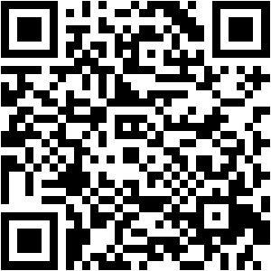

# PicToSolver 🎴

PicToSolver is a React Native mobile application built with Expo that allows users to instantly import printed bridge hands directly into the BridgeWebs/Bridge Solver engine just by taking a picture!

## Features
- **In-App Custom Image Cropper**: Bypasses unstable native OS croppers with a consistent, premium custom crop screen featuring draggable handles, a rule-of-thirds grid, and high-visibility action buttons on a dark layout. Applied to both camera captures and gallery uploads.
- **Auto Image Optimization**: Automatically optimizes and scales high-resolution images via `expo-image-manipulator` before sending them to Gemini, keeping uploads fast and light.
- **Gemini 3.5 Flash Vision Integration**: Extracts bridge diagrams directly into standard Portable Bridge Notation (PBN) formats.
- **Secure API Key Storage**: The API key is securely stored in local device storage and is masked on the Settings screen for security.
- **Scan History**: Retains your last 5 scanned boards with hand previews so you never lose your scans if you close the app.
- **In-App Bridge Solver**: Native embedding of BBO lin-parsed URLs directly into a webview for instant analysis of makeable contracts.

## How It Works
1. **Snap a photo or upload** from your gallery.
2. **Crop the hand** using our custom in-app crop editor.
3. The app passes the image to **Google's Gemini 3.5 Flash** vision model, which strictly extracts the 4 hands into standard Portable Bridge Notation (PBN).
4. The app bypasses the BridgeWebs upload page by computing the BBO `lin=` URL parameters and natively embedding the analyzed board directly into an in-app browser.
5. You can then instantly view the makeable contracts or open the exact board in your phone’s default web browser.

## How to Get a Free Google Gemini API Key
To use the app, you need a free API key from Google AI Studio (takes less than 1 minute, no credit card required):
1. Go to **[Google AI Studio API Keys](https://aistudio.google.com/app/apikey)**.
2. Sign in with your standard Google account.
3. Click **"Create API Key"** (or select an existing Google Cloud project).
4. Copy the generated key (starts with `AIzaSy...`).
5. In PicToSolver, go to **Settings**, paste your key, and tap **Save API Key**.

## Getting Started (Development)
If you are developing or running the app locally using Expo Go:
1. Obtain your API key using the steps above.
2. Run `npm install` to install dependencies.
3. Run `npx expo start --tunnel` and scan the QR code with the Expo Go app.
4. On first launch, enter your Gemini API key in the Settings screen (which is securely saved to your local device).

## Downloading the App (Permanent APK)
Because Expo Go development links expire as soon as you turn your computer off, the best way to share the app is via a standalone `.apk` build!

You can view the build details and download the compiled Android app directly here:
> **🔗 [GitHub Release v1.0.2](https://github.com/pyszkad1/PicToSolver/releases/tag/v1.0.2)**
> **🔗 [Expo Build Dashboard](https://expo.dev/accounts/apyszko/projects/PicToSolver/builds/9fddcc91-6d1c-46da-bc97-745bd45e3565)** 
> **📲 [Direct APK Download](https://expo.dev/artifacts/eas/9fddcc91-6d1c-46da-bc97-745bd45e3565.apk)** 

Alternatively, scan this permanent QR code with your Android phone to install the app:

## Built With
- **React Native** & **Expo SDK 54** (Expo Doctor certified)
- **@google/generative-ai** (Gemini 3.5 Flash Vision)
- **expo-image-manipulator** (custom crop and resize pipeline)
- **@react-native-async-storage/async-storage**
- **react-native-webview**

